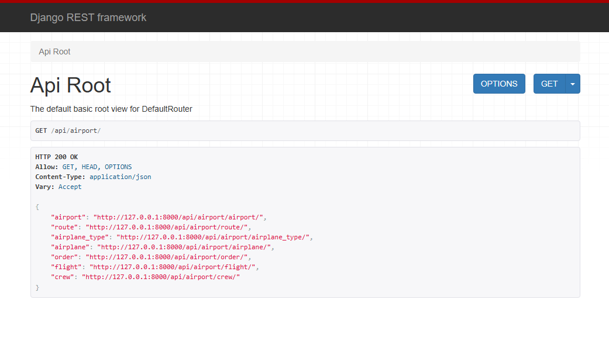
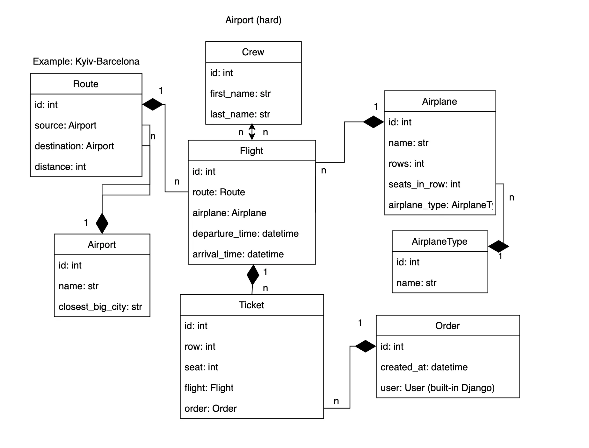

# Welcome to Airport API!

## Overview
This project is an API for an Airport app for viewing airports, airplanes, flights and ordering tickets for said flights!
- as a passerby you can check flights.
- as a logged-in user you can view other endpoints and order tickets.
- as an admin you can add new things to the database.

---

## Key Features

- Complex Models
- Postgres Database
- JWT Authentication
- User login via email
- Creation of new instances and search of existing ones with filtering
- Pagination
- Admin panel
- Documentation with Swagger
- Custom permission class
- Test coverage of some endpoints
- Possibility to add images to airplanes and crew members
- Dockerized with volumes
- Custom command for docker

---

## Tech Stack
- **Framework:** Django REST Framework (Python)
- **Database:** Postgres
- **Testing:** Django TestCase (unittest)
- **Authentication:** JSON Web Token
- **Docker**

---

## Installation
```bash
git clone <url of the repo>
python -m venv venv
source venv/bin/activate
```

**If you want to run this locally:**
```bash
pip install -r requirements.txt
set DB_NAME=<your db name>
set DB_HOST=<your db hostname>
set DB_USER=<your db user>
set DB_PASSWORD=<your db user password>
set DB_PORT=<your db port>
python manage.py migrate
python manage.py runserver
```

**If you want to run this with Docker:**
```bash
docker-compose build
docker-compose up
```

## Demo



